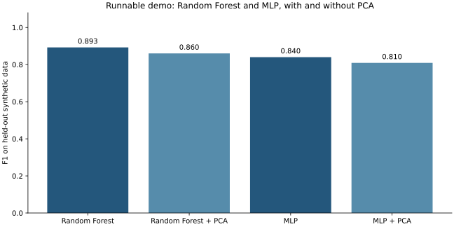
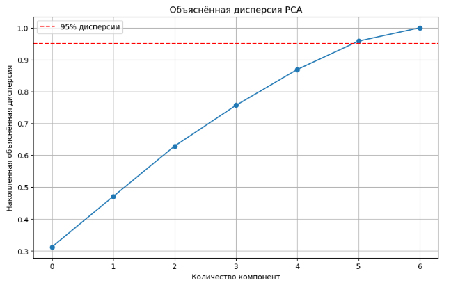
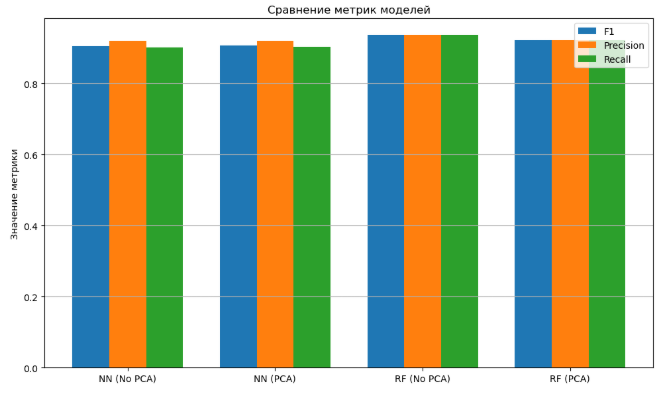

# PCA и классификация клиентов

**Python · scikit-learn · PyTorch · pandas · Matplotlib**

Учебное исследование: как сокращение числа признаков методом главных компонент
влияет на классификацию. Сопоставляются случайный лес и полносвязная нейросеть,
каждая - с PCA и без него.

В репозитории есть **исходный notebook бакалаврской ВКР 2025 года** и
**отдельная быстрая демонстрация**, которую можно запустить без исходных данных.

## Посмотреть результат



Это результат отдельной демонстрации на искусственных данных. Он не повторяет
цифры из диплома и не доказывает общее преимущество PCA.

## Быстрый запуск демонстрации

Python 3.10 или новее. PowerShell из папки проекта:

```powershell
py -3 -m venv .venv
.\.venv\Scripts\python.exe -m pip install -r requirements-demo.txt
.\.venv\Scripts\python.exe demo.py
```

На Linux использовать `python3` и `.venv/bin/python`.
В `results/demo/` появятся таблица метрик, JSON и график. Обучение идёт на CPU;
GPU и исходный клиентский CSV для демонстрации не нужны.

## Что сравнивается


Демонстрация использует `make_classification` с фиксированным seed, отдельную
тестовую часть и четыре заранее заданные конфигурации. Нейросеть в ней -
`MLPClassifier` из scikit-learn. В исходной ВКР использовался **PyTorch**;
это разные реализации, разделённые в репозитории.

## Исходная работа

[`notebooks/pca_classification.ipynb`](notebooks/pca_classification.ipynb) содержит
исходный notebook из учебной папки. Он включает обработку клиентских
данных, PCA, обучение PyTorch и Random Forest, матрицы ошибок, ROC-кривые и t-SNE.

Исходный `Customer_Data.csv` найден локально, но не распространяется вместе
с проектом: происхождение и условия публикации клиентских записей не проверены.
Для полного запуска поместите собственную совместимую копию рядом с notebook.
[Примечания к переносу](docs/export-notes.md).

<details>
<summary>Сохранённые иллюстрации из ВКР</summary>

Это изображения из документа 2025 года, а не результат нового запуска.




</details>

## Основные файлы

| Файл | Назначение |
|---|---|
| `demo.py` | Быстрый пример на искусственных данных |
| `requirements-demo.txt` | Минимальные зависимости примера |
| `notebooks/pca_classification.ipynb` | Исходный листинг исследования |
| `docs/figures/` | Исторические иллюстрации из ВКР |
| `docs/export-notes.md` | Изменения при восстановлении листинга |

## Ограничения

Результат зависит от набора данных, модели и настроек. Меньшее число признаков
не гарантирует более высокое качество. В историческом notebook тестовая часть
использовалась также для наблюдения за обучением нейросети; отдельной проверочной
части там нет. Воспроизводимые числа из `demo.py` относятся только к демонстрации.

[Другие проекты автора](https://github.com/davessii)
